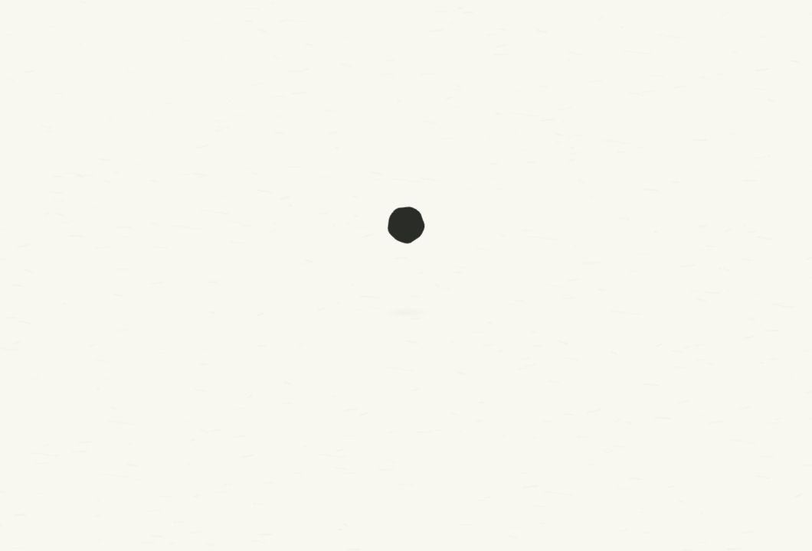

# C · 落墨成字 · 2026-10-12

先写定 [创作脚本](script.md)，再制作独立的 C 版候选。A 的默认入口与 B 的原始文件继续保留，对照页可以切换 A/B/C。

## 画面

约 **3.2 秒**，无声。近看墨珠落在宣纸上，轻微压扁后被纸吸住；中央湿墨沿纤维向两侧汇成 `Welcome, Ellen`，湿边逐渐定形，完整欢迎语静止 **0.70 秒**。镜头继续拉远，同一纸面逐渐显露实际应用界面。

墨珠、湿墨与字形在同一绘制层上持续存在。字形来自产品的实际离线字体，纸孔隙、吸墨前沿和细纤维使用固定场；按每处的到达时间形成湿边、浓墨与干燥边缘。没有水平裁切文字、逐字弹跳、圆形揭幕或飞溅粒子。最终文字保持现代无衬线排版。

动图使用 1060×720 的 **97 帧**真实浏览器画面，进入动作 3.2 秒，完整界面额外停留 1.2 秒后循环。GIF 的 30/40/30 ms 间隔补偿其 10 ms 时间精度。可交互版本每次重播播放一次。

## 预览

启动项目的 Vite 后访问 `/docs/design/app-opening-2026-10-12/preview.html?v=5&version=ink-welcome`，可以重播、查看 0–3200 ms 的时刻和静态的减少动态呈现。

直接查看 `comp.html?play`；`?t=1.12` 停在成字过程；`?reduced` 直接显示界面。开发用 `?t=0&frames` 支持 Home/End、左右键逐帧，Shift 加左右键按 1/480 s 查看子帧，供真实快门采样。此工具只存在于实验合成页。

[1080p30 草稿](draft.mp4) 使用 **310 次**真实画面采样：移动帧 4 个快门中点，静止帧 1 次，180° 快门，在线性光中求平均。完整 1920×1080 截图，无裁切归一化；没有导出尚未验收的 4K 成片或加入声音。`draft.render.json` 记录全部采样时间。快门模糊仅用于视频导出，实时 App 预览仍是浏览器自身的绘制。

## 验证

- 97 帧没有横向溢出，整个可见墨迹层在窗口内。1060×720 与 640×480 的欢迎语居中可读。
- 重访 600 ms 的截图逐像素一致。1633–2300 ms 的 21 帧逐像素一致，验证真正静止的欢迎停留段。
- 结束后的截图与配置加载完成的 A 版逐像素一致。初次 A 对照截图处于配置尚未加载的默认状态，已拒绝并重新获取同状态的截图。
- 点击、Tab 跳过、静态减少动态、正常播放完成已通过；Tab 焦点落在“开始”。正常播放测得 3200.5 ms，结束时清除镜头变换、隐藏装饰并解除界面 inert。
- OneTake 原始数值函数基于本轮 CUA 采集的 DOM 数据检查连续性和曲线；没有另启浏览器。其末尾 1.2 秒免验与画布层边界不能替代对字形、材质和最后交接的视觉判断。本次 continuity 没有检出可计分边界，返回的 1.00 分数不作为承接通过的证据。数值记录见 `checks.json`，可选曲线图因缺少 matplotlib 未生成。
- 原始视频 oracle 的节奏与静止能量检查 PASS；无爆发、单个短片区间的行变化是 advisory WARN。全画面的低能量比例 0.846 会受到大面积空白影响，不等于真正静止比例；真正停留另外通过逐像素对照确认。没有硬切或音轨。
- 正式前端构建通过，生成的 JS/CSS 名称与大小保持原有基线。未新增依赖。`preservation-checks.json` 核对 A 的 5 个源文件和 B 全部文件的 SHA-256 一致。

截图见 `contact-sheet.jpg`、`impact.jpg`、`forming.jpg`、`welcome.jpg`、`expand.jpg`、`ready.jpg`、`minimum.jpg`；验证数据见 `dom-samples.json`、`browser-checks.json`、`checks.json`。

Windows WebView2 的帧率、冷启动和重复开窗性能仍需实机验收。本轮完成的是浏览器中的真实 React 界面与候选动效，不据此宣称 Windows 性能通过。

## 参考与许可

参考为保留的 B 版，其当前草稿分析见 `reference-analysis/`：2.42 秒、没有硬切和爆发，全画面静止能量比例 0.655。C 保留产品暖纸、深墨、字体与空白，通过触纸吸墨、字形定住和单次拉远补足材质关系与交接。

动作数值复用 [OneTake](https://github.com/feitangyuan/onetake) 的 `camera/view`、`hop/impact` 和库中曲线；绘制层和吸墨字形场由本项目实现。原样库位于 `../onetake/motion.js`，PolyForm Noncommercial 1.0.0 许可与版权保留于 [LICENSE](../onetake/LICENSE)。本页是非商业设计实验，库不进入主应用的生产入口。

Required Notice: Copyright (c) 2026 Patrick. onetake is free for noncommercial use only.
