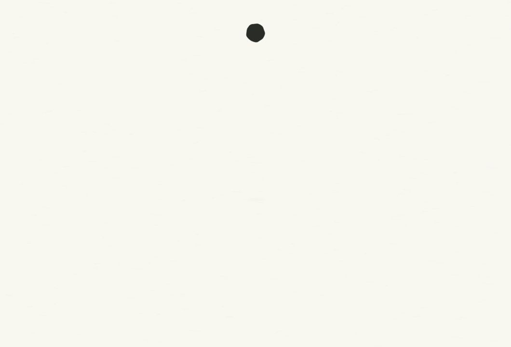

# C · 落墨成字 · 第二稿

> 2026-10-15：交互预览现已更新为 10 月 14 日确认的「墨滩第二稿」，采用固定纸面上的渗透前沿。当前实现见 [墨滩第二稿集成说明](../../ink-pool-v2/README.md)。本页历史 GIF、视频和批准基线记录仍属于此前方案。

> 2026-10-13：当前动画和欢迎语已接入 `15-withtype` 正式入口。下文保留当时实验记录；最新实现与验证范围以 [正式入口接入](../production-integration.md) 为准。历史导出不代表最新圆形墨珠和配置接线。

2026-10-13。针对首稿“落差低、生硬、缺少从墨中显字”的反馈，先修订 [脚本](script.md)，再完成这版独立候选。首稿完整保留在 [ink-welcome-v1](../ink-welcome-v1/README.md)，A/B 与生产入口保留。

## 画面

约 **3.6 秒**，静音。墨珠从画面上方加速落下，触纸轻压后铺开为一整团湿墨；墨体轮廓向笔画收拢，字腔与字间隙从墨中打开，显出 `Welcome, Ellen`。问候定形后静止 **0.70 秒**，同一镜头拉远，纸面显露真实 React 界面。

1060×720 下，墨珠中心从 y≈67.5 px 落至 y≈357.9 px，实际落差约 **290 px**。使用二次加速曲线，避免触纸前突跳。纸纤维更淡，欢迎语更轻、更小，湿墨边缘采用固定的不规则场和轻微浓淡。墨体与字形通过同一轮廓场连续变形，成字段墨层始终完全可见；没有另外叠加一行渐显文字。它是设计化的吸墨隐喻，未模拟真实流体。

动图来自 1060×720 的 **109 帧**真实浏览器画面，动作 3.6 秒，完整界面额外停留 1.2 秒后循环；GIF 的 30/40/30 ms 时长补偿 10 ms 时间精度。

## 预览与导出

启动项目 Vite 后打开 `/docs/design/app-opening-2026-10-12/preview.html?v=6&version=ink-welcome`。C 标为“第二稿 · 3.6 秒”，可重播、逐时刻查看、切换减少动态。A/B 仍可直接比较。

直接打开 `comp.html?play` 播放；`?t=1.3` 查看完整湿墨，`?t=1.6` 查看分出笔画，`?reduced` 直接显示界面。`?t=0&frames` 支持 Home/End、左右键按 1/30 秒、Shift 加左右键按 1/480 秒查看开发帧。上一稿可打开 `../ink-welcome-v1/comp.html?play`。

[1080p30 视频草稿](draft.mp4) 使用 **361 次**真实浏览器截图：移动帧 4 个快门中点，静止帧单次，**180° 快门**，在线性光中平均。109 帧编码时长 3.633 秒，实时动作时长 3.6 秒；采样记录在 `draft.render.json`。完整捕获 1920×1080，无音轨。尚未导出 4K 成片。

## 验证与边界

- 109 帧没有横向溢出，可见墨迹处于画面内；640×480 的落墨与问候也可见。截图见 `drop.jpg`、`impact.jpg`、`wet-ink.jpg`、`forming.jpg`、`welcome.jpg`、`minimum.jpg` 和 `contact-sheet.jpg`。
- 1300 ms 重访逐像素一致；2000–2667 ms 的 21 帧逐像素一致，确认完整问候真正静止。
- 湿墨的深色像素形成 **1 个连续区域**，最终问候形成 **13 个笔画区域**，深色面积由 15182 降至 3916 px；两个时刻的墨层透明度均为 1。该对照确认“墨体分出字形”，不以透明度渐显冒充成字。
- 点击、Tab 跳过、减少动态和正常播放完成通过；Tab 焦点落在“开始”。正常播放测得约 3612 ms，结束清除镜头变换、隐藏装饰并解除界面 inert。
- 最终布局与配置加载完成的 A 版逐像素一致，**仅排除现有 HUD 的动态画布**（164×56 px）。整张截图并非逐像素相同：HUD 仍按自己的时间播放，差异全部在其画布内。边界与差异记录见 `checks.json`。
- 原始 OneTake 视频 oracle 的 cadence/rest 为 PASS，无爆发与短片行变化为 advisory WARN。全画面静止能量比例 0.841 受大面积空白影响，不能代表美观或真正静止比例。实际问候停留另用像素对照确认。
- 正式前端构建通过；A 源文件、B 文件与首稿 C 的校验记录见 `preservation-checks.json`。未新增依赖，未替换生产入口。

`dom-samples.json`、`browser-checks.json`、`checks.json`、`verify.txt` 记录本稿证据。参考为保存的首稿 C，分析在 `reference-analysis/`。Windows WebView2 帧率与冷启动尚未实机验证；本稿的美术效果仍以用户观看后判断为准。

## 参考与许可

动作数值复用 [OneTake](https://github.com/feitangyuan/onetake) 的 `camera/view`、`hop/impact`、曲线；墨场和字形由本项目实现。原样库在 `../onetake/motion.js`，许可与版权保留在 [LICENSE](../onetake/LICENSE)。本页属于非商业设计实验，库没有进入主应用生产入口。

Required Notice: Copyright (c) 2026 Patrick. onetake is free for noncommercial use only.

## 欢迎语设置 · 2026-10-13

当前交互版本已支持在「外观」编辑完整欢迎语、自动保存和预览。字体大小与字形墨场按新文字重新计算，3.6 秒时间轴与镜头保持不变；入口等待保存设置读取完成后播放。实现与运行验证见 [自定义欢迎语](../../custom-welcome-2026-10-13/README.md)。本目录的静态 GIF、MP4 与 preservation-checks.json 是加入该功能前的 Ellen 美术基线，不能作为新增配置接线的当前校验。

## 初始墨珠轮廓 · 2026-10-13

按用户反馈，初始墨珠改为 Canvas 的平滑正圆，移除固定的高频径向起伏。原有下落拉伸、触纸压扁、湿墨成字及自定义欢迎语继续保留，时长仍为 3.6 秒。初始、620 ms 下落、760 ms 触纸与 2200 ms 成字已通过实际浏览器查看；脚本语法检查通过。当前初始画面见 [bead-round.jpg](bead-round.jpg)。既有视频和动图仍作为之前的美术基线，交互页展示最新轮廓。
