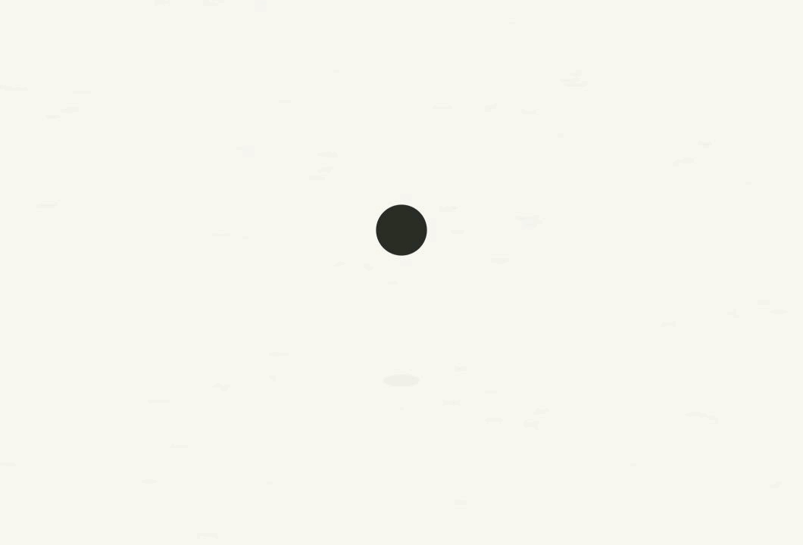

# B · 随珠入纸 · OneTake · 2026-10-12

用户选择的第二个概念已实现为独立可交互的进入动画候选，约 **2.4 秒**。当前 A 版仍是主应用的默认入口，源码与动图原样保存在 [preserved](../preserved/RESTORE.md)。

## 观看与比较

启动本项目的 Vite，打开 `/docs/design/app-opening-2026-10-12/preview.html?v=4&version=onetake`。版本菜单可切换 A（1.4 秒）和 B（2.4 秒），两版均可重播、查看任意时刻或呈现减少动态的静态界面。

动图来自 1060×720 的 73 帧真实界面，最终界面额外停留后循环，仅供观看；实际动画每次重播播放一次。

[1080p30 快门草稿](draft.mp4) 采用 180° 快门、267 次时间采样和线性光平均，快速显露段每帧 8 次采样，其余移动段 4 次，静止段 1 次。没有添加声音，没有生成尚未验收的 4K 成片。截图接口默认裁掉右侧 8 px，视频草稿将对齐的 1912×1080 采样归一化到 1920×1080；原始尺寸动图和可交互预览未做这一归一化。记录见 `draft.render.json`。

## 画面

镜头先停在悬空墨珠与纸纤维上，跟着墨珠接近落点；落纸后有压扁、低幅回弹、收放的落影和吸墨。镜头一次连续拉远，欢迎语 `Welcome, Ellen` 从同一纸面升起。五颗墨珠与文字在中轴停住，再由同一落点打开真实 App 界面。

全部动作在同一个世界层里，不切换互斥场景。界面直接挂载本项目的 React `App`，内容和交互来自当前前端；没有用截图替代界面，也没有复制他人的产品界面。欢迎语复用 `BRAND.welcome`。

[概念比较](concepts.md) 与 [节拍表](beat-sheet.md) 记录了三个初始方向、用户选择、每段的持续元素与动作库选择。纸色、墨色和字体沿用用户明确确定的产品风格。OneTake 的 `camera/view`、`hop/impact`、`gather`、`wordRise` 和 `iris` 负责数值；单文件 `comp.html` 实现 `__seek(t)` 的确定性时间合成。

## 验证

- 1060×720 的 73 帧均无横向溢出，侧墨珠保持镜像；中央墨珠和可见欢迎语完整在画面内。
- 重访 600 ms 的截图逐像素一致；欢迎语静止段 1467–1833 ms 的 12 帧逐像素一致。
- 动画最终截图与 A 版逐像素一致，布局、字体、颜色也一致。结束时清除镜头变换和遮罩，装饰隐藏，界面可正常操作。
- 640×480 验证了居中欢迎语和纸面比例；Tab 打断后焦点正常落在“开始”，点击可打断，正常播放可完成，减少动态直接显示界面。没有修改用户的系统设置。
- 对照页的 A/B 切换、1400/2400 ms 时轴端点、静态与重播控件通过实际浏览器验证。
- 原版 5 个动画相关源码文件的 SHA-256 与原样保留时一致；OneTake 库仅在此实验 HTML 中使用，不进入生产 Vite 入口。

OneTake 原始 `probe.py` 的数值函数读取 CUA 采集的 DOM 数据：一个非免验边界由同一墨珠承接，得分 1.00；最后的界面交接被宣传片算法的“结尾 1.2 秒”规则免验，不能据此宣称全部承接自动合格，因此另以同一世界层、持续节点和实际静帧确认。曲线测得主墨珠峰值 48 px/帧，界面遮罩的显露边界为 231 px/帧（按 1920 px 宽、30 fps 归一化），后者用真实快门采样导出。

原始 `verify_promo.py` 对视频的节奏和能量检查 **PASS**：节拍长度 CV 0.47、全画面静止比例 0.655、最长低能量段 2.0 秒、没有硬切。无爆发窗口和单个 4 秒区间的行变化检查为 advisory WARN，适用于本次无爆发的 2.4 秒 App 进入动作；无音轨。全画面低能量比例不能替代逐像素静止段检查。输出见 `verify.txt`。

检查数据：`checks.json`、`dom-samples.json`、`browser-checks.json`、`interface-geometry.json`；运动曲线见 `curves.png`。本次使用 CUA 执行浏览器动作，离线复用 OneTake 的原始测量函数与视频检查脚本，没有通过其他浏览器自动化程序绕过当前工具约束。

## 来源与许可

[OneTake](https://github.com/feitangyuan/onetake) 的动作库为原样副本 `motion.js`，版权与 PolyForm Noncommercial 1.0.0 许可保存在同目录的 [LICENSE](LICENSE)。本版本用于非商业的设计实验和比较；未将该库作为项目原创代码或正式安装包依赖。

Required Notice: Copyright (c) 2026 Patrick. onetake is free for noncommercial use only.

Windows WebView2 实机的流畅度与启动耗时还需后续验收，本轮证明来自浏览器里的真实 React 前端。
