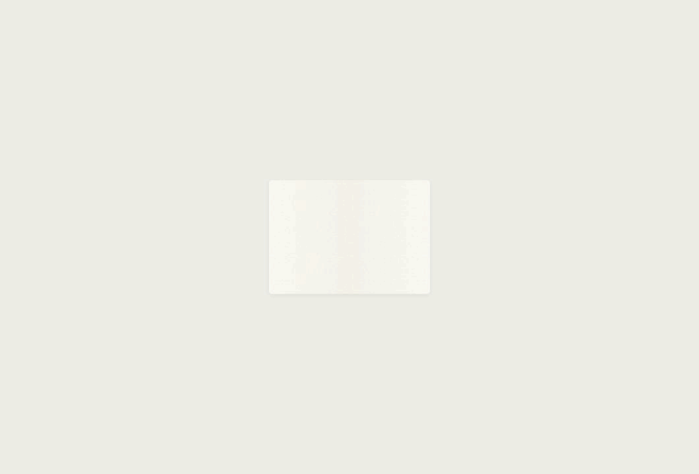

# WithType · 墨珠跃动、宣纸展开与欢迎语 · 2026-10-12

用户希望比单次落纸加纸面缩放更丰富。新版把墨珠的重量、回弹和纸面反应串成一段约 **1400 ms** 的进入动作，保持现有的暖纸、深墨与对称结构。

## 动作与节奏

1. **蓄力与跃起**：中央墨珠稍压扁后腾起约 34 px，飞行中拉长；落影随高度收缩、变淡，底部细墨丝短暂拉伸后消失。
2. **第一次落纸**（约 430 ms）：墨珠压扁，纸面轻微回弹，淡墨晕向外渗开。两侧墨珠从中央分离，沿镜像轨迹跃起。
3. **再次回弹与落纸**（约 780 ms）：中央与两侧以较小的幅度回弹，出现第二层淡墨晕和外侧小墨点。纸上的柔和弧线向两边展开，带动后续舒展。
4. **宣纸展开**（约 770–1230 ms）：细纤维、中央折痕和两翼明暗构成纸面材质；纸面从中央舒展到窗口，折痕和墨迹逐步淡去。
5. **界面显露**（约 910–1400 ms）：侧栏与工作区分别从中间方向收束到最终位置，纸面装饰退场，保留正常界面。

欢迎语 **Welcome, Ellen** 在第一次落纸后渐显（约 462–644 ms），居中位于墨珠下方；随纸面展开淡出，到约 1148 ms 完全消失。总时长仍为 1400 ms。当前使用用户给出的示例文案，集中在 `src/ui/brand.js` 的 `BRAND.welcome`，未读取或推断系统用户名。

宣纸起始宽度在 1060×720 下约 244 px，在最小窗口 640×480 下约 230 px。小窗口保持墨珠与纸面的比例，未简单等比缩小整个场景。墨晕是浅色吸墨效果，不使用高亮水波或全屏粒子。

## 实际预览

动图由实际界面的 **41 帧** 截图组成。为方便观看，最终界面停留后循环；应用每次进入仅播放一次。

运行本机 Vite 后打开 `/docs/design/app-opening-2026-10-12/preview.html?v=3`，可重播、查看 0–1400 ms 的任意时刻，以及查看减少动态的静态呈现。预览参数只在开发环境生效。

[无欢迎语的第二版动图](opening-rich.gif) 与 [第一版记录](simple/README.md) 保留，供对照。

## 行为与验证

- 点击或按键立即完成动画，原操作继续；装饰层不接收鼠标或辅助技术焦点。窗口隐藏时停止未完成的动画。
- 系统减少动态时直接显示完整界面，播放期间偏好改变也会停止。未更改用户系统设置；静态预览走相同的呈现路径。
- 仅主窗口首次进入、隐藏/最小化后经应用入口重新打开触发，普通导航和聚焦不重播；HUD 与结果卡片不参与。
- 本轮 `npm test` 157 项通过，最终前端构建通过，没有新增依赖。原生打开事件沿用上一版通过 macOS 编译检查的实现。
- 1060×720 的 41 帧均无横向溢出；两侧墨珠位移与透明度保持镜像，界面不透明度单调增加。检查记录见 `rich-frame-checks.json`。
- 欢迎语的 41 帧检查均居中且无横向溢出；640×480 下文字完整落在纸面内；正常结束和减少动态时不残留欢迎语。记录见 `welcome-frame-checks.json`，静帧见 `welcome.jpg` 与 `welcome-minimum.jpg`。
- 实际浏览器验证：640×480 的纸面比例和布局；点击进入服务设置；Tab 打断并正常移动焦点；正常播放完成后清理；预览滑杆可到 1400 ms，减少动态与重播控件正常。
- 主要运动使用 transform 与 opacity；纸纹为静态 SVG，模糊滤镜仅作用于很小的墨晕区域。Windows WebView2 的实机流畅度、冷启动和重新打开仍需验收。

实现：`src/ui/AppEntrance.jsx` 与 `src/styles.css`。验证期间没有请求模型服务、修改快捷键或保存实际个人短语。
