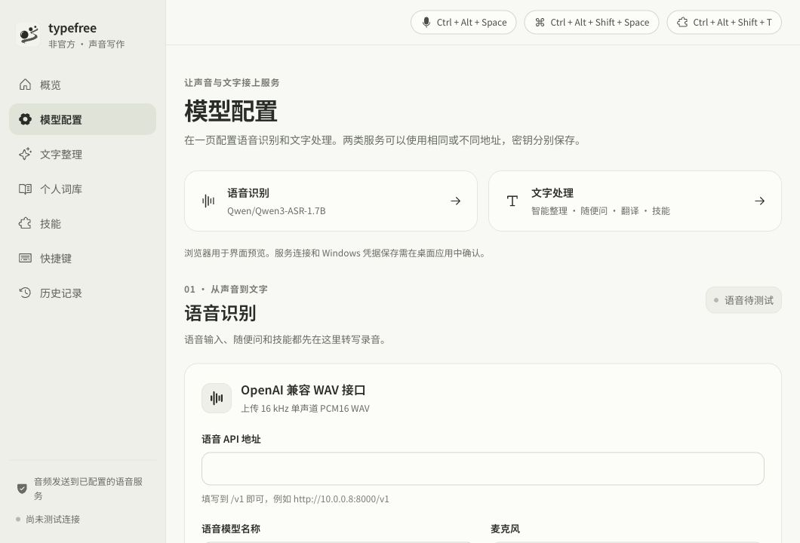

# 网页与 Windows 桌面前端一致性

2026-10-10。用户要求前端完整延续网页设计、显示名统一 `typefree`，并提交推送。

## 共同渲染路径

| 部分 | 浏览器预览 | Windows 桌面 |
| --- | --- | --- |
| 入口与样式 | `index.html → src/main.jsx → App.jsx`，`styles.css` | Tauri 加载同一次 Vite 构建的 `dist/client`，相同入口与 CSS |
| 窗口分流 | URL 的 card / overlay 参数 | 原生窗口 main / answer / overlay label，设置相同 data-surface |
| 主界面 | Sidebar / Overview / ModelSettings / SkillEditor 等 | 同一组件，没有另一份 Windows 界面实现 |
| 问答 / 技能卡片 | AnswerCard | 同一个 AnswerCard，原生窗口可拖动和缩放 |
| HUD | Overlay / VoiceMotion | 同一个 Overlay / VoiceMotion，按实时 DPR 绘制 |
| 图标 | public/assets/typefree-ink-v2.svg | 前端相同 SVG；原生窗口、托盘、安装程序使用同造型 ICO |
| 字体 | 随包 Noto Sans SC 可变 WOFF2 | 相同字体字形、100–900 字重与字号/行高；不请求在线字体 |

浏览器不可用的原生设备、全局快捷键、凭据、登录启动和音频恢复功能保留对应控件/结构，禁用或说明预览能力；桌面使用真实状态。示例历史/静态问答只用于浏览器，桌面首次运行不伪造数据。系统权限和真实模型连接仍在桌面完成。

## 本轮修正

1. 名称：侧栏、浏览器标题、主窗口标题、托盘/退出菜单统一 `typefree`；录音/问答窗口只附功能名；便携包与 CI 产物名同步更新。原应用 identifier、localStorage 键、凭据项与启动项保留以兼容已有数据。
2. 字体：使用固定版本官方 Noto Sans SC，保留字形，仅转 WOFF2；许可/版权随安装包和便携包分发。主界面、卡片、HUD、快捷键/规则文字共享字体；统一滚动条样式。字体约 7.8MB，安装包相应增加。
3. 内容区：正常工作区保留主窗口 **1060×720 逻辑像素的 WebView 内容区**，标题栏与边框额外计入。整窗超过工作区时才缩小内容区并降低最小尺寸。此前把原生边框从设计尺寸中直接扣除，会使同一设计在桌面提前换行。
4. 原生窗口：main / overlay / answer 都明确使用浅色主题和 WebView 缩放 1.0，关闭浏览器缩放快捷键；HUD/卡片背景透明、无原生阴影，阴影和纸色在相同 CSS 中绘制。
5. 打包：字体、SVG、CSS/JS 都进入 `dist/client`；Tauri frontendDist 指向该目录，无远程样式/字体依赖。

## 检查与边界

- 源码/资源契约覆盖共同 Vite 入口、三窗尺寸/主题/缩放、名称/旧标识兼容、字体哈希/许可和图标/打包路径。
- Rust 几何检查覆盖 100/125/150/200% DPI 的内容区尺寸、负坐标工作区、标题栏总矩形以及小工作区收缩；它们不能证明原生窗口实测通过。
- 前端构建后核对输出字体和 SVG 与源码字节一致。
- 当前宿主机为 macOS，未运行 Windows EXE。Windows 10/11 的 WebView2 实际字体加载、透明边缘、系统光栅化、任务栏/焦点与 DPI 变化仍按 [验收清单](windows-ui-skills-2026-10-10.md#windows-验收) 和 [失败处理方案](../windows-remediation.md) 复验。不能用浏览器截图宣称 Windows 实机已通过。

## 已完成检查

| 检查 | 结果 |
| --- | --- |
| `npm run build` | 通过，桌面输出位于 `dist/client`；仍有现有单个 JS 包超过 500KB 的提示 |
| `npm test` | 147 项通过，含 5 项桌面资源/配置契约；目录式测试入口在当前 Node 下不识别 `.mjs`，已改为跨平台显式枚举文件 |
| Mac `cargo test --offline --lib` | 25 项通过，含 3 项 DPI/边框/工作区几何检查；这是 Mac 可编译部分，不能当作 Windows API 验收 |
| 生产资源核对 | WOFF2 / SVG 与 public 源文件 SHA-256 完全一致，字体许可已包含于产物与打包清单 |
| 浏览器预览 | 标题/侧栏为 `typefree`；1060×720 无水平溢出，字体 CSS 与 preload 指向随包资源，控制台无资源/字体错误 |
| Windows EXE / 安装包 | 未在本机执行，仍按 Windows 清单实机复验 |

图片来自浏览器 1060×720 CSS 视口，不是 Windows 实机截图。
