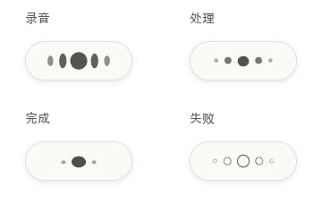
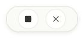
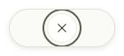
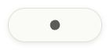

# HUD 比例与墨珠反馈修订 · 2026-10-11

当前实现：最新版 `/Users/outsider/SEVB/Type` 的 c84d53d 工作区。本次修订替代 [上一版 HUD 改进](../improved/implementation.md)，原审查及截图保留作为历史记录。

用户要求：缩窄 HUD，接受悬停按钮覆盖墨珠，重新设计处理、完成、失败，优先考虑设计感与协调感。采用 Taste Skill 中保留品牌、比例、克制的原则，以及 apple-design 中连续变化与可打断的反馈规则。

## 比例与交互

- 纸色胶囊从 **176×54** 收紧为 **120×44**；墨珠画布保持 **76×26**。胶囊缩窄约 32%，由内容的比例决定宽度。
- 原生外壳同步从 **196×74** 改为 **140×64**，保留四周 10px 阴影留白。`floating.rs` 的原生定位尺寸与 `tauri.conf.json` 同步，原生焦点、DPI 转换与工作区定位逻辑保留。
- 悬停或浏览器聚焦时，墨珠淡出，结束、取消按钮居中替换；非录音时单个取消/关闭按钮居中。按钮仍为 34×34，无需为两端预留常驻空间。
- 可见状态文字继续移除；保留上一版的温和辅助功能播报和细分阶段映射。触摸环境直接呈现适用的控制按钮。

## 一组墨珠的连续变化

| 状态 | 形态与动作 |
| --- | --- |
| 录音 | 墨珠随 55ms 短时电平变化，静音收为一珠。保留中央主珠和两侧镜像的层次。 |
| 处理 | 五颗圆润墨珠按中央、内侧、外侧的节奏轻跃，两侧镜像，幅度小于录音时的电平变化。 |
| 完成 | 外侧淡去，墨珠落下时轻压、放松，主珠稍稍舒展，两侧留下小珠后静止。取消上一版的完成圆环。 |
| 失败 | 填充墨色退去，五颗墨珠变为空心后停住。取消上一版的错误色与裂瓣，保持相同墨色与结构。 |

几何、透明度通过现有引擎的状态弹簧连续变化；状态被打断时从已呈现的形态继续。减少动态效果时停止装饰性跃动与落下压缩，保留静态状态差异和录音电平反馈。主窗口继续使用原来的墨珠效果。

## 复验

- `npm test`：**152 项通过**。HUD 测试覆盖左右镜像、画布边界、帧率变化、连续可见、不同状态、减少动态效果、被新状态打断时不跳换形态。
- `npm run build`：通过。已有的主 JS 包超过 500kB 提示仍在，本次没有新增依赖。
- 独立编译当前 `floating.rs` 后运行几何测试：**3 项通过**，覆盖 100/125/150/200% DPI、负坐标、工作区与尺寸钳制。前端合约测试也校验配置与 Rust HUD 尺寸一致。
- `git -c core.whitespace=cr-at-eol diff --check`：通过。
- 浏览器实测：120×44 胶囊中心与 76×26 画布中心一致；录音按钮中心 x=97/143，相对 x=120 镜像；处理时单按钮中心为 x=120。
- 悬停/聚焦时墨珠透明度为 0，控制为 1；移出后恢复为 1/0。聚焦按钮的焦点环保留。结束预览录音进入处理，取消预览处理返回待机。
- 实看并保存录音、静音、处理、完成、失败与覆盖式控制画面。动态预览由实际浏览器截图帧组成，不是重新绘制的示意动效。

## 证据与边界

截图来自 240×160 浏览器视口，裁剪为包含阴影留白的 140×64 CSS 像素。组合预览中的状态标题在截图外，HUD 内无可见状态文字。

没有执行真实麦克风、Windows 原生运行或屏幕阅读器朗读验证。独立几何测试不等于完整 Tauri/Windows 构建；原生 `focusable:false`，浏览器按钮聚焦不代表原生窗口接受 Tab 聚焦。

悬停控制：

静音：

