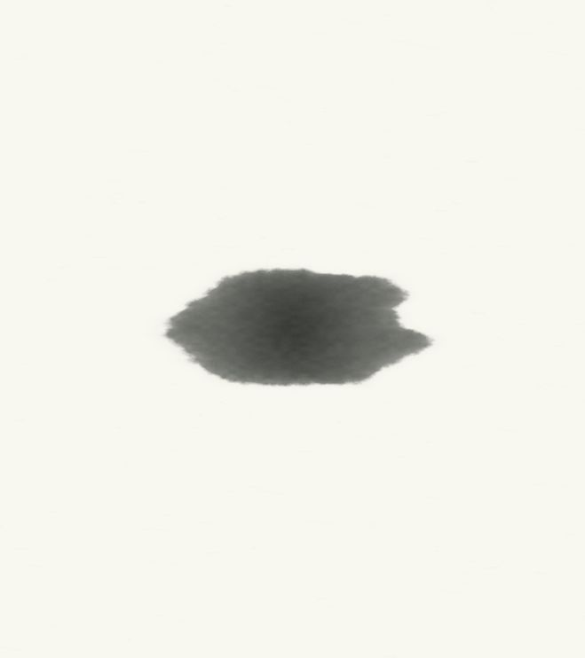

# 墨滩第二稿 · 当前仓库集成

2026-10-15。将用户于 10 月 14 日确认、随后在 `withtype-latest` 工作目录实现的第二稿及宣纸主题合入当前 `15-withtype` 仓库。此前 `afa1728` 尚未包含这些未提交的视觉改动。

## 当前行为

- 墨珠在 0.70 秒触纸，湿润前沿沿固定纸面的渗透场推进，已沉积的墨纹保持原位；1.24–2.12 秒由墨迹收拢成字，总时长 3.6 秒。
- 复用确认稿的 `inkWelcome.js`、`inkArrival.js`、离线字体、镜头与参数；保留自定义欢迎语、跳过、重播、减少动态和窗口生命周期处理。
- 同步预览中的宣纸配色、主窗口背景、静态纸纤维和控件样式。字体加载与绘制统一使用随包 Noto Sans SC 对应的 `Typefree UI` 名称。
- 正式入口和 C 交互预览共用当前绘制器；C 标为「墨滩第二稿」。历史 GIF、MP4 和 `approved-reference.html` 仍代表早期方案，不能用于确认当前版本。
- 外观构建基线纳入纸面渗透算法及宣纸样式。Vite 只扫描应用入口，避免恢复归档中的其他项目干扰预览。

## 验证

合入时逐文件核对上述实现与用户已确认目录的 SHA-256，并确认 Windows 输入投递与语音输入源码保持合入前内容。渗透场测试覆盖确定性、有限到达时间、固定触点、纸纤维方向及吸收率差异；已有测试继续覆盖播放、重播、跳过、减少动态和欢迎语配置。

本次 237 项测试中 235 项通过，2 项 Windows 专用测试在 macOS 上跳过；`npm run build`、`npm run verify:appearance` 与 `git diff --check` 通过。已在当前仓库的实际应用入口核对 1.1 秒渗透帧、随包字体、Esc 跳过及从头重播，重播约 3612 毫秒后正常进入界面。C 对照入口的版本标签与减少动态模式也已核对，静态模式结束于 3.6 秒并解除界面 inert。下图为本次实际画面。Windows WebView2 与安装包运行效果仍需 Windows 实机核验。

## 预览

运行 `npm run dev`，打开应用，在「外观 → 预览进入动画」重播。对照入口为 `/docs/design/app-opening-2026-10-12/preview.html?version=ink-welcome`，支持重播、查看指定时刻与减少动态。
