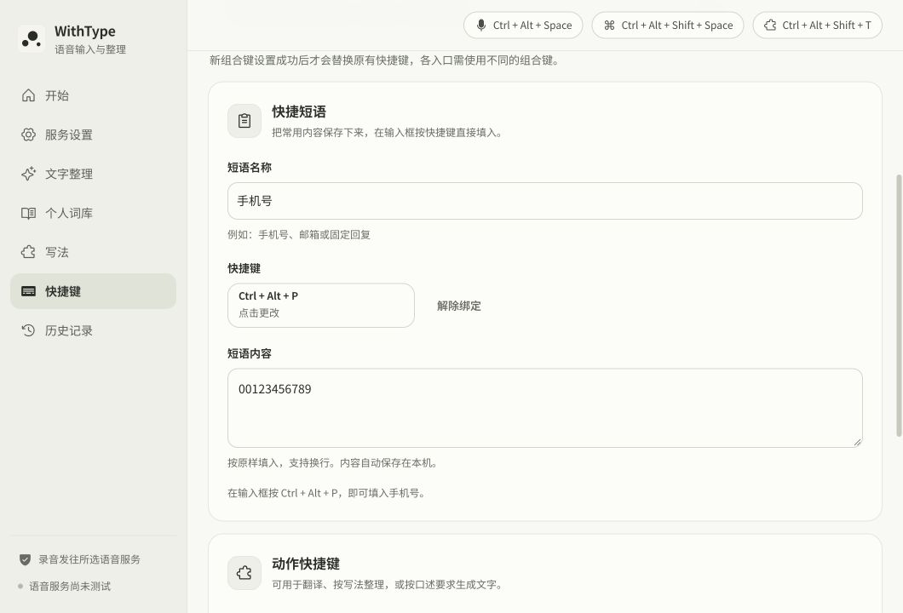

# WithType · 快捷短语 · 2026-10-12

在“快捷键”页新增一条快捷短语，填写名称、内容和独立快捷键。在目标输入框按一次组合键即可按原样填入内容，支持前导零、空格和换行。解除绑定会保留内容。

第一版支持一条短语；旧配置默认留空，不占用现有快捷键。名称最多 40 字，内容最多 2000 字。设置通过现有 `settings.json` 保存，输入内容不进入语音识别、文字模型、词库学习或历史记录。

## 原生实现

- 第四个可选全局快捷键，和录音、提问、动作入口共用冲突检查与键盘捕获。
- 按下时固定短语和目标窗口，等待 Ctrl、Alt、Shift、Win 松开再输入；目标窗口改变时停止。
- 复用 Ctrl+V 和原有文本剪贴板备份/恢复。新增共享输入租约，剪贴板恢复结束前拒绝重叠投递，避免连续输入同一短语破坏备份；短语自身忽略处理期间的重复按键。
- 输入不受语音“自动输入结果”开关影响。输入空内容时提示填写，注册失败保留旧快捷键；重启注册失败会提示重新设置并保留短语内容。
- HUD 与录音状态不参与此入口。反馈只发给主窗口，不携带短语内容。

源码：`src/App.jsx`、`src/text/settingsMigration.js`、`src-tauri/src/lib.rs`、`src-tauri/src/quick_phrase.rs`。

## 验证结果

- `npm test`：157 项通过，包括旧配置兼容、前导零与换行保留、双向快捷键冲突。
- 新增纯 Rust 模块：5 项测试通过，覆盖空内容、长度与空字符限制、原样保存、重叠投递和错误返回释放租约。
- `npm run build`：通过；已有 500 kB 主包提示仍在，未新增依赖。
- macOS 本机 `cargo check --offline`：通过，使用本机官方缓存，不修改全局源配置。
- 浏览器实际操作：填写与快捷键录制、冲突提示、Esc 取消、刷新保留、解除绑定保留内容、多行保存通过。1060×720 和 640×480 下无横向溢出。
- 截图中的 `00123456789` 为测试示例；预览测试结束后名称、内容、绑定恢复为空，没有填入实际个人号码。

Windows 全应用交叉检查停在 `ring` 依赖缺少 Windows SDK 的 `assert.h`，未到应用代码检查。当前机器无法验证 Windows 全局按键及实际跨应用输入；不得将浏览器预览或 macOS 编译视为 Windows 验收通过。

## Windows 验收步骤

1. 保存示例短语 `00123456789`，绑定一个未占用的组合键。在记事本、浏览器输入框和常用聊天软件中验证只填入一次，前导零保持。
2. 保持修饰键按住再松开，确认输入发生在松开后；长按不重复填入。按键等待期间切换应用，应停止此次输入。
3. 验证空内容、与三个录音入口冲突、被其他程序占用时的提示；失败后旧键仍可用。快捷键捕获期间不触发填入。
4. 编辑为多行文字，关闭并重启应用，验证内容与绑定恢复。解除绑定后按旧键不填入，文字仍保留。
5. 放入一段原有文本剪贴板，输入后确认恢复；快速连续按键或与语音投递重叠，不破坏剪贴板备份。关闭语音自动输入开关，短语仍直接填入。
6. 检查没有录音、模型请求、词库学习或新增历史记录，原有三个快捷键仍正常。

