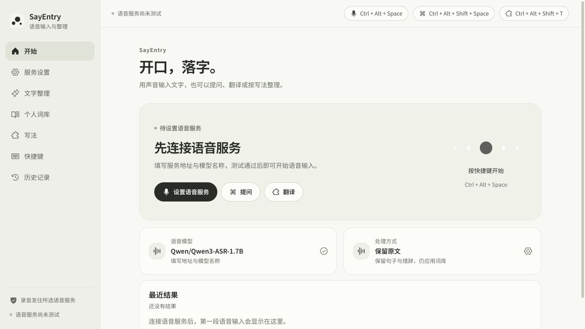
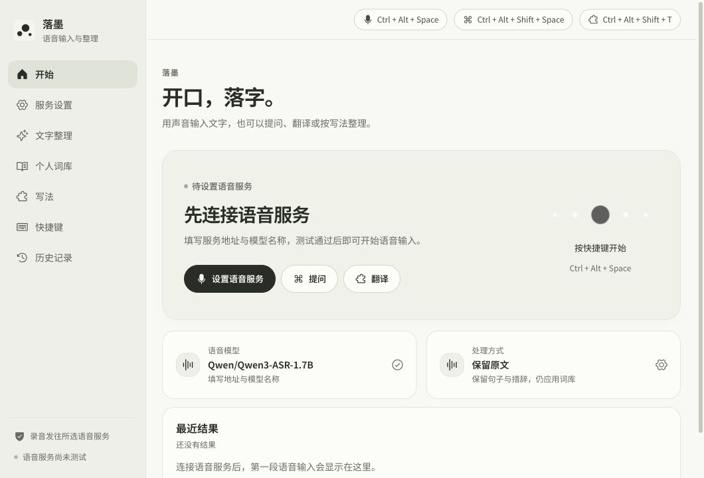
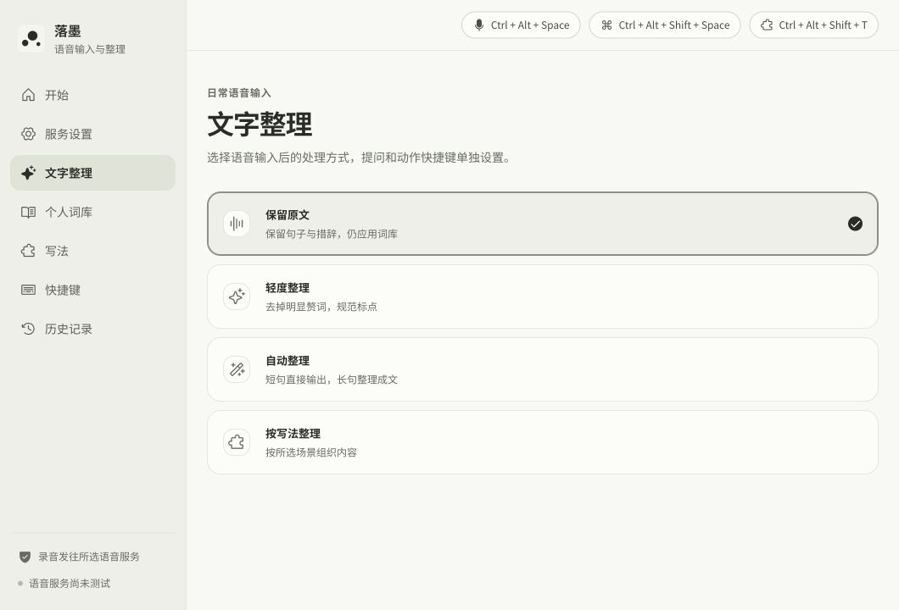
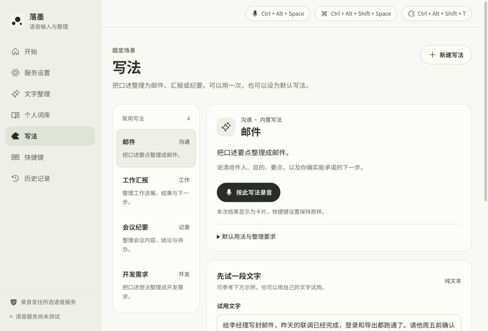
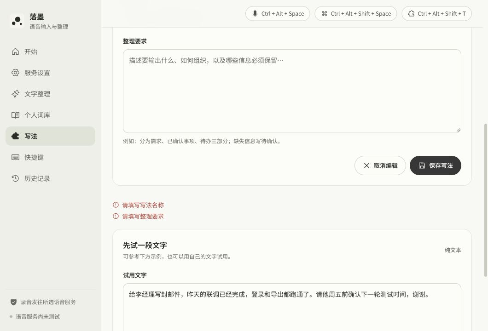
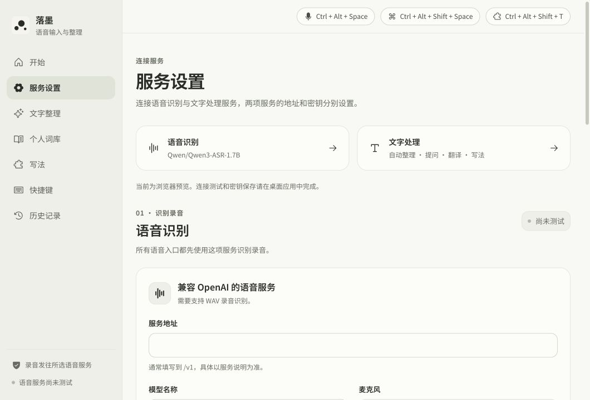
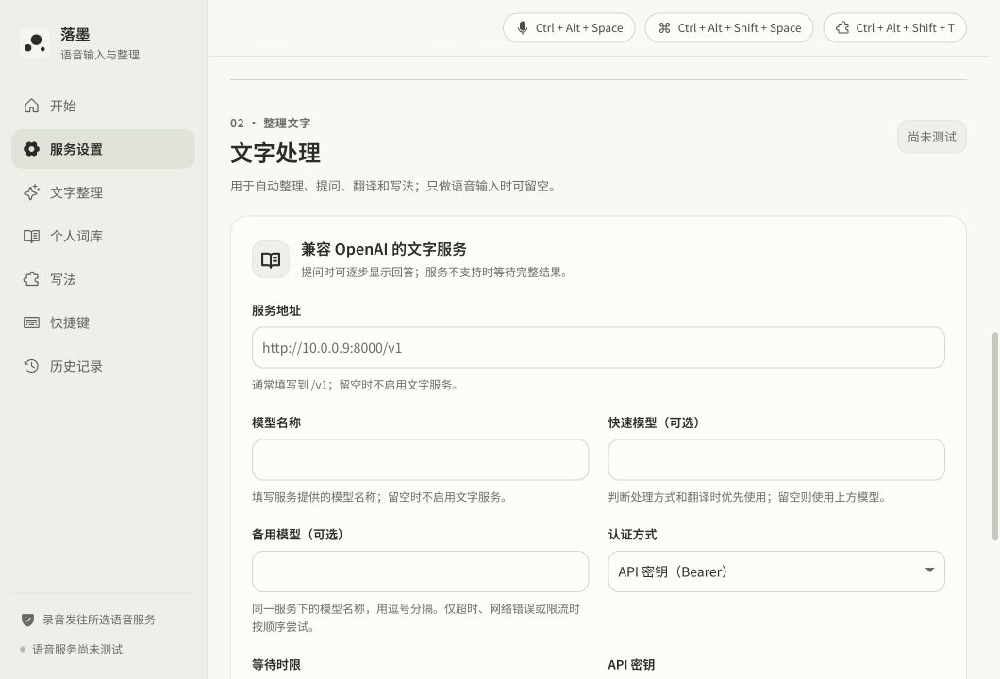

# SayEntry · 命名与界面文案 · 2026-10-11

> 历史方案。用户已最终选定 WithType，当前名称与文案见 [WithType 文案规范](../withtype-copy-2026-10-12/README.md)。

本版对应最新版 `/Users/outsider/SEVB/Type` 的当前工作区。命名是可直接试用的本地设计方向；偏好取自本次对话中对“墨珠在宣纸上跳动”、比例、协调感和克制反馈的要求。

## 命名方向

| 名称 | 表达 | 判断 |
| --- | --- | --- |
| **SayEntry** | Say（说话）与 Entry（录入），用声音输入文字 | 本版采用。八个字母，两个常见英文单词，优先表达产品功能。 |
| TalkEntry | 说话与录入 | 口语感更强，也容易让人联想到对话记录。 |
| Saystroke | 说话与键击、笔画 | 可承接纸墨视觉，但含义需要更多解释。 |

显示名称：**SayEntry**。功能说明：**语音输入与整理**。主文案：**开口，落字。**

根据用户补充要求，英文名称优先表达语音输入。SayEntry 将说话与录入放在名称中，功能说明与主文案继续使用中文。保持已有图标、纸色与墨珠语言，设置页直接说明功能。

## 文案规范

1. 页面标题用功能名：文字整理、个人词库、写法、快捷键、历史记录、服务设置。
2. 按钮用明确动作：设置语音服务、新建写法、保存写法、输入原文、复制回答。
3. 普通说明用日常语言，不拟人化模型、不堆叠抒情句子。功能描述以实际行为为准。
4. 状态说明报告已知事实：“测试通过”不写成“服务在线”或“服务正常”。
5. 错误提示指出下一步，例如“请填写写法名称”“已有同名写法，请换一个名称”。
6. 保留决定服务兼容性所需的 OpenAI、WAV、模型名称与认证信息；减少 PCM 编码、接口响应字段等内部说明。
7. 简短标签不加句号，完整说明使用中文标点；等待状态使用“正在…”，省略号使用“…”字符。
8. 音频与文字去向、Windows 加密保存、密钥分别保存、试用是否自动输入等信息继续明确显示。

## 统一术语

| 原表达 | 本版表达 | 使用范围 |
| --- | --- | --- |
| typefree / 落墨 | SayEntry | 界面、窗口标题、托盘、安装器显示名称、历史导出名称 |
| 随便问 | 提问 | 主入口、快捷键、托盘与回答卡片 |
| 技能 / Skill / 固定写法 | 写法 | 场景选择、编辑、试用、绑定、校验与提示 |
| 语音命令 | 语音指令 | 根据口述要求生成文字的入口 |
| 智能整理 | 自动整理 | 根据内容长短选择直接输出或文字整理 |
| 模型配置 | 服务设置 | 连接语音与文字服务的页面 |
| 术语纠错 / 原文 | 保留原文 | 不改写句子，仍应用词库；重复选项在界面合并 |
| Vibe Coding | 开发需求 | 内置写法名称，原 ID 与整理规则保留 |
| 手动词典 | 手动规则 | 每行“正确写法=误写1\|误写2”的规则区 |
| 已经记住 / 等待再次纠正 | 已保存词条 / 待确认词条 | 自动学习的有效规则与候选 |
| API Key / ASR API Key | API 密钥 / 语音密钥 | 服务表单与可见错误提示 |
| 上屏 / 插入原文 | 输入 / 输入原文 | 耗时、结果与恢复操作；内部命令名保留 |

“口述”仍可用于说明说话内容，“语音输入”是功能名；“模型”仍用于实际的模型名称，服务连接统一称“服务”。

## 页面调整举例

| 位置 | 调整前 | 调整后 |
| --- | --- | --- |
| 首页标题 | 说出来，写下去。 | 开口，落字。 |
| 未配置时的首页卡片 | 让思绪，自然落在纸上。 | 先连接语音服务 |
| 文字整理标题 | 整理到刚刚好。 | 文字整理 |
| 写法标题 | 选个场景，再开口。 | 写法 |
| 快捷键标题 | 按一次开始，再按一次完成。 | 快捷键，操作方式放在说明中 |
| 历史标题 | 最近说过的话 | 历史记录 |
| 提问卡片副标题 | 留一点空间，把问题想清楚 | 可以继续追问 |
| 轻度整理说明 | 去口头禅与断句 | 去掉明显赘词，规范标点 |
| 原文空提示 | 配置语音服务后，第一段口述会显示在这里 | 连接语音服务后，第一段语音输入会显示在这里 |
| 输入方式说明 | 说完后输入到当前窗口 | 说完后按设置输入或复制文字 |

## 实现与兼容

- `src/ui/brand.js` 集中管理名称、功能说明与主文案；登录启动说明也直接引用品牌名称。
- 原生窗口、托盘、安装器可见名称与前端名称同步。保留 `typefree` 二进制名称、`app.typefree.windows.unofficial` 应用标识、凭据服务名称与已有存储键，以继续读取当前配置和记录；此轮没有迁移数据或发布安装包。
- 历史导出下载名为“SayEntry-历史记录.json”。
- 原“术语纠错”与“原文”在当前流水线中都做词库替换、不改写句子。界面合并为“保留原文”；已有 `corrected` 值继续有效，并在界面映射为同一选项，包括选中标记。没有删除旧配置值。
- `builtin.vibe-coding` 显示为“开发需求”，内置 ID、提示词、系统约束及数据格式保留。
- “API 密钥”的新错误文案仍被认证失败分类器识别，同时兼容旧 “API Key” 文案。
- 原项目及参考实现的来源与许可保留在 README、THIRD_PARTY_NOTICES 和随包许可文件中。

## 验证

- `npm test`：**152 项通过**。包含名称与原生窗口同步、持久化身份、配置迁移、写法校验、取消竞态、认证失败分类、复制/输入行为与 HUD 回归。
- `npm run build`：通过。已有的主 JS 包超过 500kB 提示仍在，本次未新增依赖。
- `git -c core.whitespace=cr-at-eol diff --check`：通过。
- 英文名调整后重新运行上述测试与构建；1280×720 浏览器实测标题与侧栏名称均为 SayEntry，名称未溢出，无横向滚动。
- 1060×720 浏览器实测：首页、文字整理、词库、写法、快捷键、历史、服务设置；无横向溢出。文字整理显示四个不同选项，并有清晰选中标记。
- 写法编辑器提交空草稿时显示“请填写写法名称”“请填写整理要求”，随后取消编辑，没有新增写法。
- 460×520 的提问卡片实测：标题、继续追问说明、输入框与复制操作均正确，卡片可见宽度 440，无横向溢出。
- 已复验页面中的可见旧称，不再出现“技能”“随便问”“ASR 服务”“API Key”“术语纠错”。源码注释、数据标识、服务返回的原始消息及用户历史内容不属于界面术语替换范围。

上述图片是实际浏览器预览。未运行真实麦克风、Windows 安装器、托盘或全量 Rust 编译；原生名称完成源码与合约校验，Windows 实机仍需验收。历史空状态与恢复提示按源码核对，未通过清空用户记录制造空状态。

## 界面对照

当前英文名称：首页。

以下保留上轮中文文案改进时的实测截图，侧栏使用的是当时的中文名称。

首页调整前：

首页调整后：

文字整理与写法：

表单提示：

服务与提问卡片：

