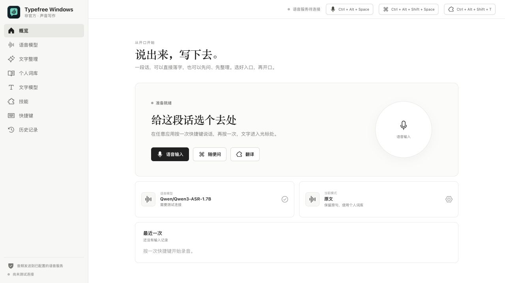
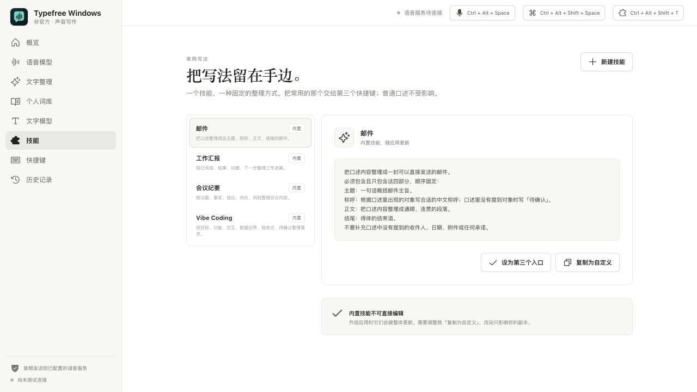
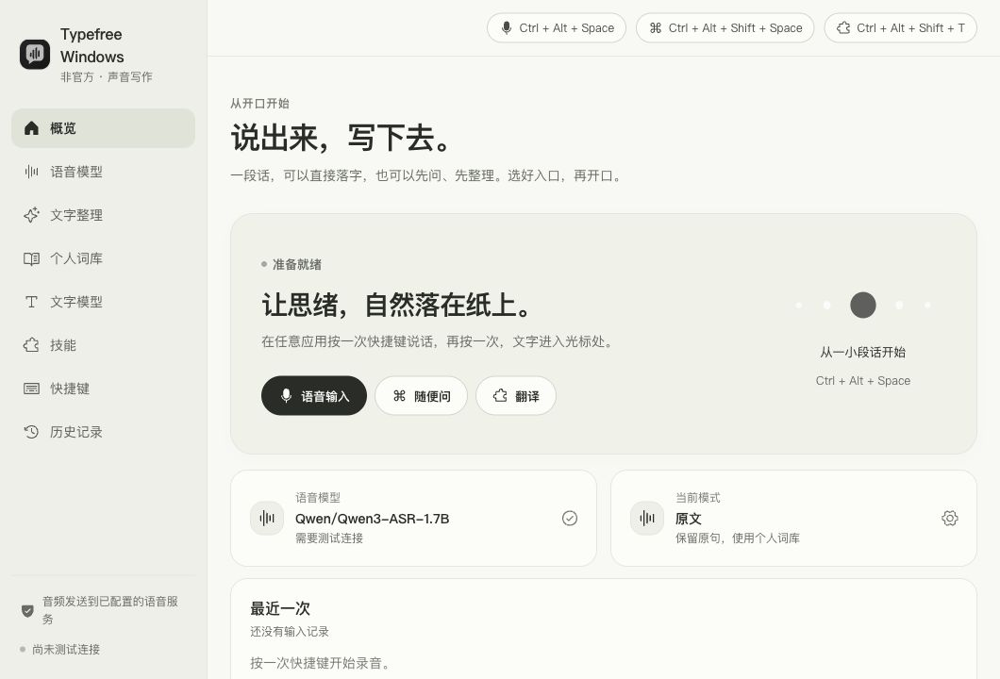
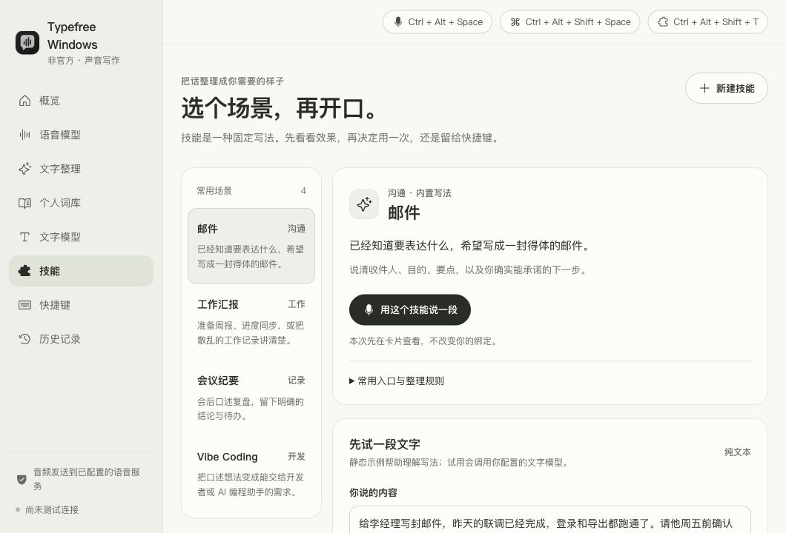
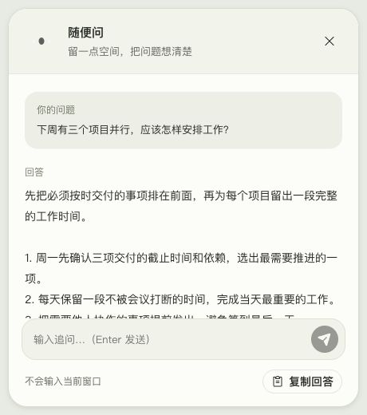
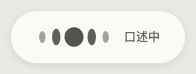
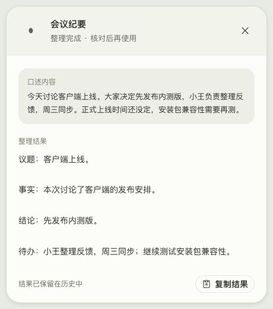
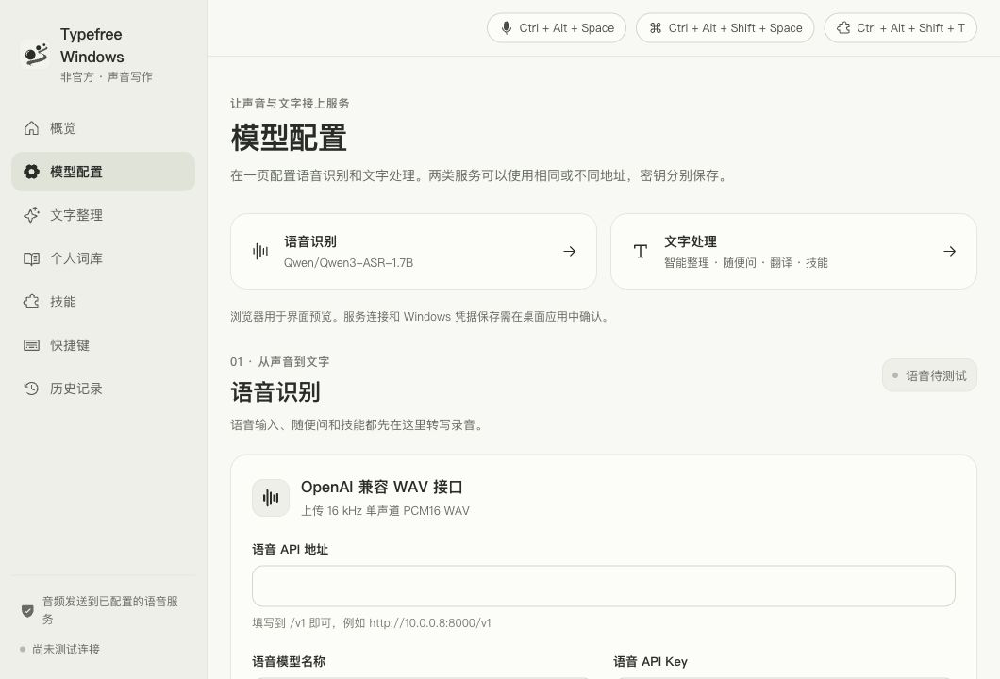
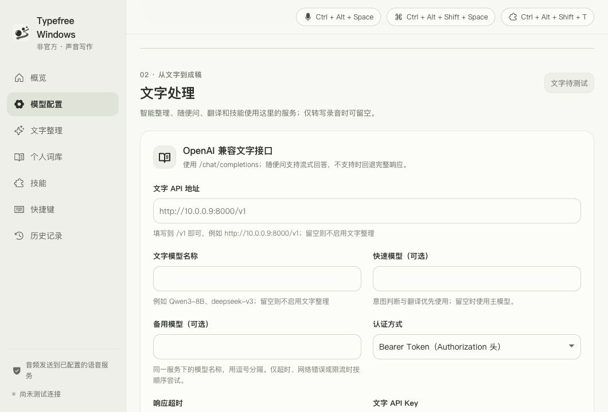
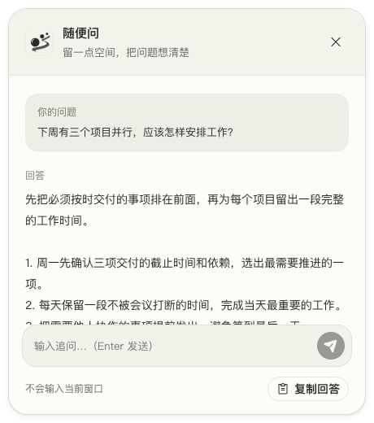

# Windows 界面与 Skill 优化 · 2026-10-10

本轮基于独立仓库 9d2fd56，使用现有 D 墨珠引擎与本轮实际捕获截图。浏览器证据不覆盖 Windows 原生窗口。

## 当前体验检查

1. **主界面（可操作，阅读层级偏弱）**：入口清楚，但正文与提示过小；麦克风圆形装饰没有延续墨珠语言。改为统一纸色/墨色、可读字号、真实墨珠反馈。

2. **技能（可配置，使用路径不清楚）**：场景、输入示例、结果示例、一次执行入口缺失；“第三个入口”文案不能直接说明是哪组快捷键。先呈现场景和示例，再提供一次使用与两种绑定。

3. **问答卡片（可追问，正文空间紧张）**：窗口 420×320，页脚和输入占比较大；无明显拖动区域和复制反馈。扩大初始阅读尺寸，加入拖动、Esc 关闭、滚动、清晰的追问与复制状态。

4. **墨珠 HUD（原生显示待 Windows 复验）**：源码尺寸改成 88×46，根元素最小宽度 320；定位使用完整屏幕并随鼠标变化。浏览器最小视口为 240×160，无法作为 88×46 原生窗口的合格截图证据。统一窗口尺寸与工作区定位，将逻辑尺寸换算与原生定位集中在独立几何模块，覆盖不同 DPI、负坐标副屏、侧边任务栏和小工作区。

## Skill 的三条使用路径

| 路径 | 场景 | 触发 | 影响范围 |
| --- | --- | --- | --- |
| 用一次 | 临时写邮件、整理会议/汇报/需求 | 技能页“用这个技能说一段” | 当前录音快照；结果卡片 |
| 动作快捷键 | 重复做同一种格式输出 | 绑定动作快捷键 | 动作入口；日常口述不改变 |
| 日常口述 | 一段时间持续使用固定写法 | 设为日常口述 | 普通语音输入，直到用户换模式 |

技能仅整理用户提供的内容；没有联网、文件读取或执行本地操作能力。示例是静态参考；“试用”才请求当前文字模型。技能页的一次使用在卡片查看；动作快捷键的技能结果可选择直接输入或先在卡片查看。日常口述保持既有输入路径。

## Windows 验收

- **UI-01** 低分辨率或高缩放笔记本：主窗口启动时（含标题栏与边框）适应工作区，侧栏可滚动，页面内容不因固定最小高度被截断。
- **UI-02** 100%、125%、150%、200%：墨珠可见区域 176×54 逻辑像素，无裁切；问答初始 460×520，可拖动、可缩放。
- **UI-03** 卡片拖动/缩放后继续接收回答不跳回默认位置；Esc、关闭按钮和 Alt+F4 都可关闭并取消请求，下一次提问仍可重新打开。
- **UI-04** 多屏、负坐标屏、顶部/底部/侧边任务栏：HUD 在录音开始时的鼠标屏幕工作区底部居中，录音/识别/完成过程中不跳屏。
- **UI-05** 开始录音后移动鼠标到另一屏，HUD 保持会话屏；下一次录音按新的屏幕定位。
- **UI-06** 主窗口宽度 640/860/1060、卡片窄窗口、长问题/长回答：无水平溢出，内容可滚动，键盘焦点可见。
- **UI-07** 技能一次使用不改变绑定；绑定动作不改变日常模式；日常技能删除后安全回退。
- **UI-08** 文字模型缺失、失败与取消：没有误粘贴；卡片模式不调用 paste_text；输入模式遵守已有 autoPaste 设置。

- **UI-09** 新应用图标在桌面、任务栏、托盘、安装程序、侧栏与问答卡片保持相同的纸色/墨色和墨珠笔迹造型；16/20/32/48 px 可辨认。
- **UI-10** 侧栏只有“模型配置”；页内语音/文字各有地址、模型、密钥与测试按钮。改动一组配置不覆盖另一组；重启后保留原配置，密钥继续独立存入凭据库。

每项失败时的处理与复验标准见 [Windows 未通过验收处理方案](../windows-remediation.md#界面与-skill)。

## 本轮实现与检查结果

### 视觉结果

以下图片来自运行中的 React 页面；主界面/技能页在 1060×720 iframe 中捕获，浮动卡片在 460×520 iframe 中捕获，HUD 在 196×74 iframe 中捕获。iframe 用于提供与窗口内容区一致的 CSS 视口，不能证明 Windows 原生边框、透明、焦点或 DPI 行为。

### 实现

- `src/styles.css`、`src/voice/VoiceMotion.jsx`：共用纸色、墨色和圆角；Windows 优先的本地字体；字号与焦点反馈；同一墨珠引擎按实时 DPR 绘制。小主窗口折叠导航文本，侧栏与内容分别滚动。
- `src-tauri/src/floating.rs`、`src-tauri/src/lib.rs`：统一逻辑尺寸到物理像素换算；根据工作区和显示器原点定位；录音状态变化保留会话屏幕；高缩放小屏的尺寸和最小尺寸适应可用区域。主窗口计算包含原生标题栏和边框的总矩形。
- `src/components/AnswerCard.jsx`：共享问答/技能结果阅读卡片；首次非流式回答从顶部阅读，流式更新在用户仍跟随时滚动；拖动区域、复制反馈、Esc 关闭、中文输入法防误发送、窄窗口布局。
- 卡片同一请求的最终回答不重定位或重置尺寸；关闭后迟到结果不能重新打开。Windows Alt+F4 隐藏并复用 WebView，前端同时取消当前回答/追问请求。
- `src/text/skillScenarios.js`、`src/components/SkillEditor.jsx`：四个既有场景说明、输入与输出示例；一次使用、动作绑定和日常写法；先试用，再展开配置。原始整理规则收在展开区。
- `src/dictation/pipeline.js`：一次使用以指定技能创建任务快照；卡片模式不经过粘贴路径；同一运行期的失败重试保留技能 ID 与结果去向。已有动作配置默认保持输入方式，日常口述沿用原上屏路径。

### 已完成的检查

| 项目 | 结果 |
| --- | --- |
| `npm run build` | 通过；Vite 仍提示现有单个 JS 包超过 500 kB |
| Mac `cargo check --offline` | 通过；现有 Windows 音频模块在 Mac 上有未使用项警告 |
| 主界面 1060×720、640×440 | 浏览器检查无横向溢出，小高度侧栏可滚动 |
| 技能页 1060×720、860×620 | 浏览器检查无横向溢出 |
| 卡片 460×520、360×320 | 内容区可滚动，首次阅读位置为顶部，控件保留 |
| HUD 196×74 | 浏览器实际可见区域 176×54，根元素 scrollWidth 为 196，无旧 320px 溢出 |
| 技能场景切换、展开入口、复制并取消编辑 | 浏览器实际操作完成，示例随场景变化，取消恢复详情 |
| Windows 原生 DPI、多屏、透明与焦点 | 待 Windows 10/11 按上方清单复验；本轮没有构建或运行 Windows EXE |

本机 Rust 检查从临时目录执行并使用已有 crates.io 缓存；仓库的 rsproxy 源配置和 Windows 构建方式保持。截图使用静态示例内容，未调用用户的 ASR 或文字服务。自动化测试未在本轮新增或运行。

## 图标、模型配置与失败处理补充

用户随后指定三颗墨珠沿笔迹前行的参考图。最终图标保留前行动势，省去飞溅、纹理和复杂高光，使用当前暖纸与深墨色，几何成稿和 Windows 资源版本化保存。问答卡片左上角与侧栏共用 AppIcon；原生托盘、窗口、bundle、安装程序和 favicon 都指向 v2。图标过程见 [交付记录](../../icon-design/README.md)。

语音/文字导航合到“模型配置”：同页两个分区，各自地址、模型、密钥和测试；配置字段和凭据保持独立，旧配置无需迁移。页首可直接定位分区。参数变化或密钥更新使测试状态失效，过期请求不标通过，保存密钥和连接测试不能同时执行；浏览器只展示预览说明，不伪报真实连接。

新增 [失败处理方案](../windows-remediation.md)：43 个编号与完整验收 / UI 清单逐项对应，无缺项；每项给出现场处理、源码定位 / 修复方向和复验标准。

| 本轮补充检查 | 结果与边界 |
| --- | --- |
| 前端构建 / Mac Rust 编译检查 | 通过；仍有既有大 JS 包提示和 Mac 平台音频未使用项警告 |
| 图标资产 | master 为 1024×1024；九尺寸 PNG 为 RGBA，外角透明；ICO 七帧 16/24/32/48/64/128/256；直接查看 20/32/48px 和 master |
| 模型配置 640×480 / 860×620 / 1060×720 | 浏览器页面与两个分区无横向溢出，分区定位可用，模型下拉框统一 44px 高 |
| 问答卡片 460×520 / 360×320 | 浏览器可见新图标，图片加载成功，窄窗口无横向溢出；正文区域滚动 |
| 服务与 Windows 原生显示 | 没有请求用户的真实 ASR / 文字服务，也没有执行 Windows EXE；原生显示、凭据和安装器仍按编号复验 |

此处新截图来自显式设置的浏览器 CSS 视口（不是 iframe 或 Windows 原生窗口）。临时图标对照页刷新曾遇到自动审批超时；实际应用预览已恢复，侧栏和问答卡片的 SVG 均确认加载。未在本轮新增或执行自动化测试。
