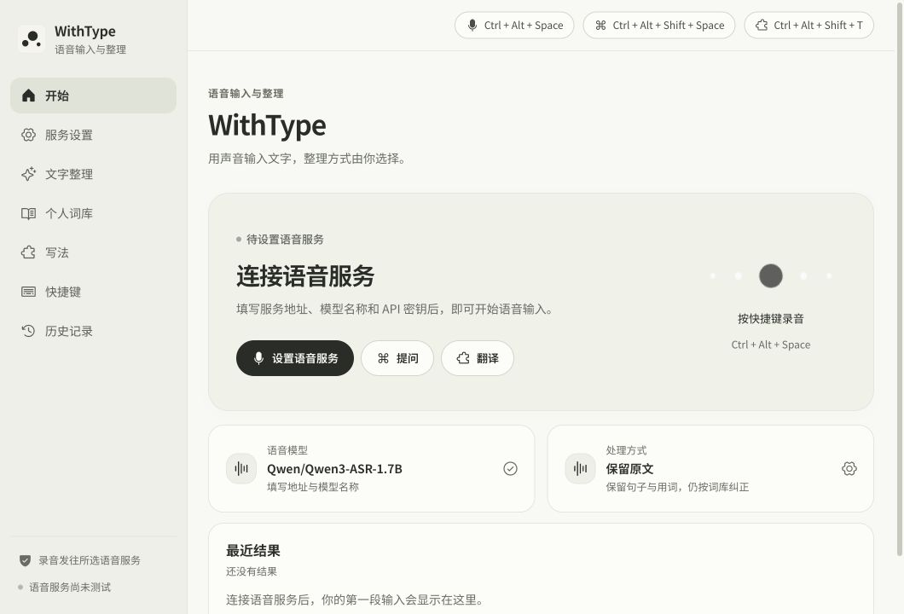
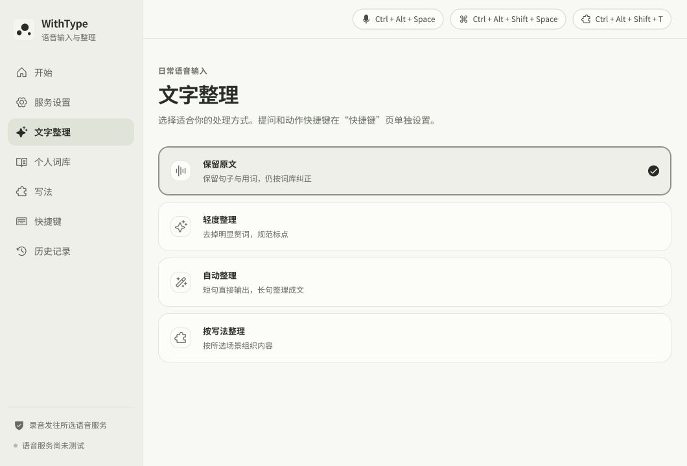
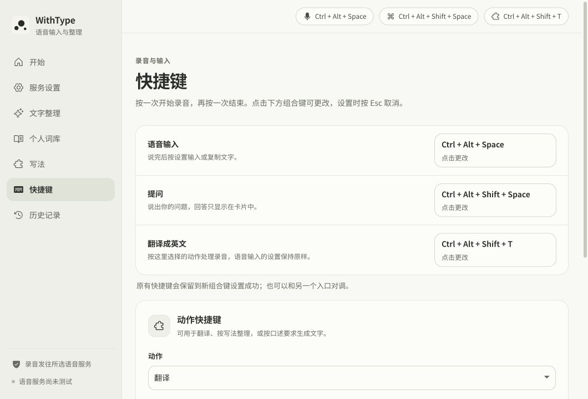
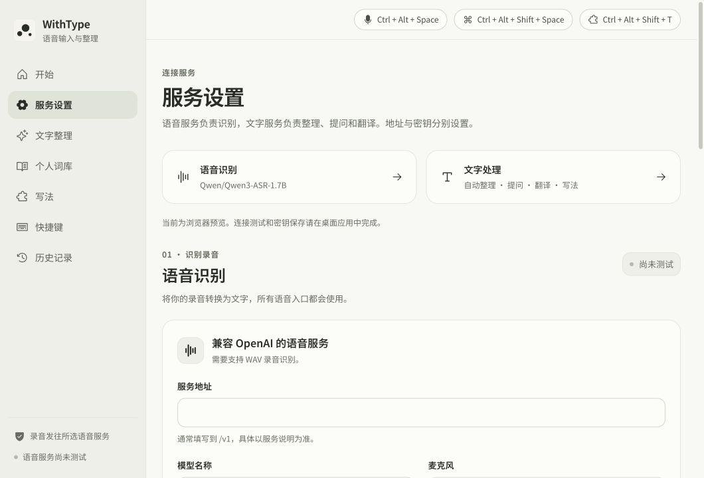

# WithType · 名称与界面文案 · 2026-10-12

对应最新版 `/Users/outsider/SEVB/Type` 的当前工作区。用户最终选定 **WithType**，名称表达输入工具的陪伴感；现有纸色、墨珠与 HUD 继续承载视觉意象。

## 品牌与首页

- 产品名称：**WithType**。
- 功能说明：**语音输入与整理**。
- 首页主标题：**WithType**。
- 首页介绍：**用声音输入文字，整理方式由你选择。**

品牌名称承担主标题，其他文字说明用途与下一步。此前“开口，落字。”退出当前界面；设置页保持功能标题。

## 语气与术语

1. 温和、直接，适度使用“你的”“自己的”，不把服务拟人化，也不声称已了解用户的写作习惯。
2. 标题用功能名，按钮用实际动作：语音输入、提问、文字整理、个人词库、写法、快捷键、历史记录、服务设置。
3. 页面说明表达用户能决定的内容：处理方式、常用词、整理要求、结果去向。
4. 状态只报告已知事实：测试通过、正在识别、正在整理、正在回答；连接测试通过不等同于持续在线。
5. 错误提示说明问题和下一步；用户配置所需的 API 密钥、OpenAI、WAV、模型名称继续明确显示。
6. 保留影响使用的条件：结果按设置输入或复制；词条需两次独立纠正确认；预览不自动输入或保存历史；文字服务与语音服务分别设置。
7. 简短标签不加句号，完整说明使用中文标点。“正在…”与省略号保持一致。

## 本轮调整

| 位置 | 原文 | 当前文案 |
| --- | --- | --- |
| 首页主标题 | 开口，落字。 | WithType |
| 首页介绍 | 用声音输入文字，也可以提问、翻译或按写法整理。 | 用声音输入文字，整理方式由你选择。 |
| 初次设置卡片标题 | 先连接语音服务 | 连接语音服务 |
| 初次设置说明 | 填写服务地址与模型名称，测试通过后即可开始语音输入。 | 填写服务地址、模型名称和 API 密钥后，即可开始语音输入。 |
| 文字整理介绍 | 选择语音输入后的处理方式，提问和动作快捷键单独设置。 | 选择适合你的处理方式。提问和动作快捷键在“快捷键”页单独设置。 |
| 个人词库介绍 | 保存常用词的正确写法，用于后续语音输入。 | 收录你常用的名字和术语，在后续输入中纠正误识别。 |
| 写法介绍 | 把口述整理为邮件、汇报或纪要。可以用一次，也可以设为默认写法。 | 为邮件、汇报或纪要选择写法，也可以保存自己的整理要求。 |
| 写法试用标题 | 先试一段文字 | 试用写法 |
| 试用说明 | 可参考下方示例，也可以用自己的文字试用。 | 先用一段自己的文字，看看整理结果是否合适。 |
| 纠正说明 | 改正识别错误，保存后记住可学习的短词 | 改正这段文字，符合条件的短词会加入词库 |

首页录音状态说明如何结束录音，移除“墨珠随声音变化”的动效解释。提问与写法卡片共用状态标签来源，分别显示“正在回答”与“正在整理”。

## “Skill”与“写法”的能力范围

当前实现是**声明式文字整理预设**。每项保存名称、场景说明、整理要求与输出格式，能试用、用于一次录音，或绑定日常输入及动作快捷键。

执行过程为语音识别、词库纠正、按保存的要求调用文字模型，最后输入文字或显示结果卡片。各写法共用这条处理流程。备用模型和失败重试属于共享流程；单项写法没有独立的工具、资料包或多步任务执行逻辑。“邮件”生成文本，不会寻找收件人或发送邮件。

Skill 可以宽泛地指可复用能力；当前产品界面使用“写法”更能准确表达用户得到的功能。无需为了使用 Skill 这个名字增加工具执行能力。内部 `skill` ID、保存格式和命令仍按原约定工作。

代码依据：`src/text/builtinSkills.js` 的声明式配置、`buildMessages()` 的消息组装、`src/dictation/pipeline.js` 的 `finishTask()` 和 `preview()`、`src/text/skillValidation.js` 的保存字段。

## 实现与验证

- 名称统一到侧栏、首页、浏览器标题、原生窗口、托盘与安装器配置；历史导出文件名为 `WithType-历史记录.json`。
- `src/ui/brand.js` 集中提供名称、功能说明与首页介绍，登录启动说明也引用该名称。
- 原二进制名称、应用标识、凭据服务名称和持久化键继续用于读取已有配置与记录，未迁移数据。来源与许可证继续保留。
- `npm test`：**152 项通过**。
- `npm run build`：通过；已有的大于 500kB 主包提示仍在，本轮未新增依赖。
- `git -c core.whitespace=cr-at-eol diff --check`：通过。
- 实际浏览器检查：首页、文字整理、个人词库、写法、快捷键、历史、服务设置，在 **1060×720** 与最小窗口 **640×480** 下无横向溢出。
- 提问与写法结果卡片在 **460×520** 下检查，可见卡片宽度 **440**，标题、说明与结果去向正常，无横向溢出。记录见 `card-checks.json`。
- 当前页面不再出现 SayEntry、Inklilt、“开口，落字。”或“墨珠随声音变化”。旧设计记录按历史方案保留，并链接到本记录。

上述截图为实际浏览器预览；记录和结果卡片中的内容为已有预览示例。此轮没有调用真实语音或文字服务、保存密钥、改动快捷键、删除历史或发布安装包。原生名称完成源码与合约核对，Windows 托盘、安装器及实机交互尚未验收。

## 当前界面

