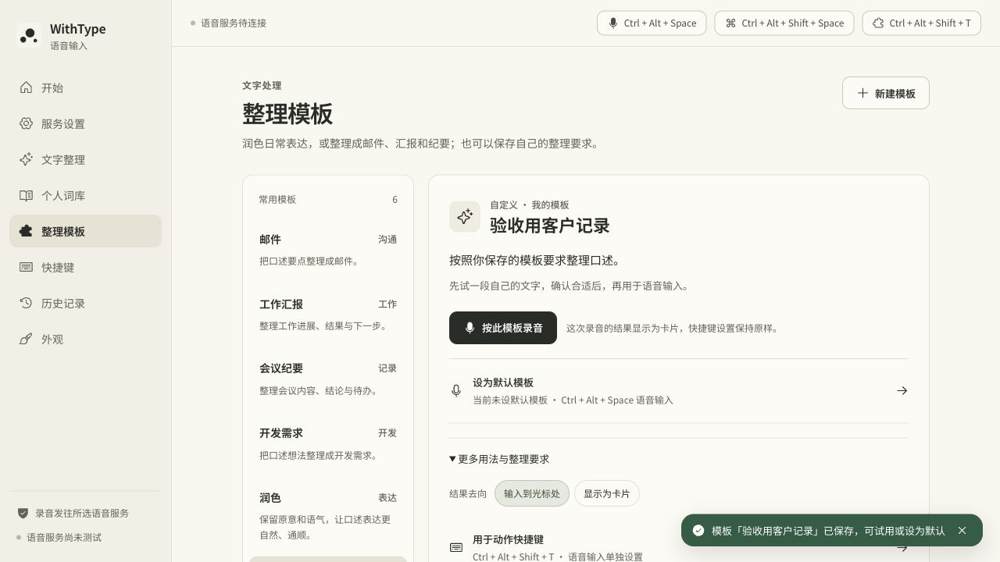

# Skill v2 自定义模板优化与测试报告

日期：2026-10-20，Asia/Shanghai。

> 本文记录 10 月 20 日完整工作区的验证。10 月 21 日整理本地提交时另行验证了独立的 Windows 源码快照，见[推送前复查](../skill-v2-windows-source-2026-10-21.md)。

结论：模板编辑、数据迁移与保存、执行样例、缺项策略、试用和正式任务的一致性已通过下述测试。真实模型效果尚未验收：已配置的 `api.deepseek.com` 在本环境发生 DNS 解析失败，16 次优化前后请求尝试均未获得模型输出。本文没有将模拟响应或测试通过数作为成稿质量证明。

## 已完成的改动

- 新建模板仅需名称和整理要求；说明与参考样例选填，缺项默认省略空栏目。
- 每模板支持最多 3 组执行样例，每项最多 2000 个 Unicode 码点，全部样例合计最多 8000；空白整组忽略，单边缺失或超限拒绝保存。前端与 Rust 使用相同限制。
- 增加“省略空栏目／标为待确认”策略。保留口述明确表达的未定信息；模板策略负责栏目缺项，统一事实规则不再强制所有模板写占位。
- 样例实际参与生成：system 规则、参考输入输出消息对、本次材料；普通整理、问答和翻译不携带模板样例。
- 编辑器允许修改试用结果，并主动加入样例草稿；保存后生效。模板或试用输入变化后，旧结果不能继续保存为样例。
- 试用与正式模板任务共用消息组装；录音开始时复制完整模板，后续修改嵌套样例不改变在途任务。
- 结构版本升为 2，内容修订单独计数；旧模板保持 ID、整理要求、更新时间和原有待确认策略，新增字段缺失不导致旧模板丢弃。
- 内置模板可复制并调整，复制时独立复制样例；模型设置、快捷键、投递位置仍由应用配置。

本轮没有增加自动语义选模板、读屏、脚本执行或导入导出。默认任务仍是按用途整理口述素材。

## 执行环境与范围

- macOS ARM64；Node.js v25.2.1，项目现有 React / Vite / Tauri / Rust 依赖。
- 从现有工作区增量修改，保留此前已有的未提交改动；本轮未创建 Git 提交。
- 浏览器验收使用独立本机端口 `http://127.0.0.1:5198`。测试模板及假服务配置只存在该浏览器预览环境，未覆盖桌面应用的模型配置或真实模板文件。
- 浏览器中的文字服务采用原有模拟兜底返回，现已明确显示“试用仅模拟交互”；浏览器结果只验证编辑流程。
- Rust 测试实际读写临时模板文件；不是对已安装 App 的原生 UI 操作。

## 自动化实测结果

| 检查 | 实际结果 | 复现命令 |
| --- | --- | --- |
| 模板专项测试 | 40 通过，0 失败 | `npm run test:skills` |
| 全部 JavaScript 测试 | 265 通过，2 跳过，0 失败 | `npm run test:unit` |
| Rust 原生模块测试 | 84 通过，0 失败 | `cargo test --lib --manifest-path src-tauri/Cargo.toml` |
| 前端生产构建 | 通过 | `npm run build` |
| 外观、字体与产物资源检查 | 通过 | `npm run verify:appearance` |
| Mac ARM64 App 构建及签名完整性 | 通过 | `bash build-macos.sh` |

专项测试属于全部 JavaScript 测试的子集，不要把两项相加计算独立覆盖。跳过项是现有 Windows 专用检查，不能视为 Windows 实机通过。

本轮新增的行为测试覆盖：v1 迁移及未来版本拒绝、样例与策略 JSON 往返、复制后不共享嵌套样例、完整性及字符总预算、Unicode 边界、内容修订、真实运行时消息角色、正式任务与试用请求一致、试用不投递、录音快照不受后续模板编辑影响。Rust 另验证原生磁盘往返与约束。

日志：[模板专项](template-tests.log)、[JavaScript 全量](unit-tests.log)、[Rust](rust-tests.log)、[前端构建](frontend-build.log)、[Mac 构建](macos-build.log)。[机器可读摘要](verification-summary.json)保留结果与范围。

## 界面实际操作验收

以下步骤已在 Codex 内置浏览器执行。可启动 `npm run dev -- --host 127.0.0.1 --port 5198`，进入 `/?page=skills&opening=reduced` 重复执行。

| 编号 | 操作 | 应观察到的结果 | 本次 |
| --- | --- | --- | --- |
| UI-01 | 新建“验收用客户记录”，只填写名称与整理要求 | 场景可以留空，默认省略空栏目 | 通过 |
| UI-02 | 添加一组样例，只填原始口述，点击保存 | 显示“请同时填写原始口述和期望结果”；草稿保留 | 通过 |
| UI-03 | 补齐期望结果并保存，然后刷新页面 | 模板仍存在；显示 1 组样例、省略空栏目、版本 1 | 通过 |
| UI-04 | 进入服务设置，在浏览器预览填写假地址 `https://example.invalid/v1` 和模型 `ui-test-only`，返回模板试用 | 显示模拟试用说明；结果可编辑；不保存密钥 | 通过 |
| UI-05 | 修改模拟结果，点击“保存为参考样例” | 出现含第二组样例的编辑草稿；提示保存后生效 | 通过 |
| UI-06 | 观察修改后旧试用结果的操作状态 | 显示配置已更改；旧结果的保存样例按钮禁用 | 通过 |
| UI-07 | 将缺项策略改为待确认并保存 | 显示 2 组样例、待确认策略、版本 2 | 通过 |
| UI-09 | 规则或样例带末尾空白时试用 | 返回后仍可保存为样例，不误判过期 | 通过 |
| UI-10 | 试用后真正修改整理要求 | 旧结果标为过期，保存样例按钮禁用 | 通过 |
| UI-08 | 分别以 1280×720 和 640×480 查看编辑表单 | 未发现横向溢出；最小窗口 9 个表单控件右边界均为 590px，小于 640px | 通过 |

“假地址”仅用于已有浏览器模拟路径，不是可用模型服务。原生端进行真实试用时必须使用有效服务。

界面证据：[空白归一化](trial-whitespace.png)、[真实改动使结果过期](trial-stale.png)、[最终 DOM](ui-final-dom.txt)、[样例编辑](editor-examples.png)、[最终编辑表单](editor-final.png)、[640×480](editor-640.png)。



## 真实模型测试：已执行，因 DNS 受阻

使用桌面应用现有文字配置：`deepseek-flash`、温度 0.2、非流式。凭据在进程内从现有系统钥匙串读取，没有写入报告、脚本或前端。测试材料全部为虚构文字，不涉及麦克风或用户历史。

8 个固定用例，各做旧组装和新组装一次，共 16 次尝试：

| 用例 | 检查目标 | 本次状态 |
| --- | --- | --- |
| omit-empty | 省略缺项且不虚构问题 | 未取得响应 |
| mark-empty | 缺项标待确认 | 未取得响应 |
| numbers-negation | 3500 元、未定付款日期与不承诺到账 | 未取得响应 |
| example-isolation | 样例的客户和金额不进入本次结果 | 未取得响应 |
| example-style | 能否参考“进展｜／阻塞｜”写法 | 未取得响应 |
| english-template | 自定义英文回复与承诺边界 | 未取得响应 |
| markdown-template | Markdown 结构与日期保留 | 未取得响应 |
| short-natural | 短句否定、不确定性及无占位 | 未取得响应 |

实际记录：[model-results.json](model-results.json)。Node 请求返回 `fetch failed`；独立 curl 连通性检查也返回 `Resolving timed out after 20005 milliseconds`、HTTP 000。凭据可读取不代表服务可连接。本次没有模型输出，也没有可报告的成稿可用率或优化效果提升。

### 网络恢复后的可执行重跑

在项目根目录执行：

```bash
# 先单独验证一个用例；会调用已配置的真实文字模型。
npm run test:skills:model -- --case omit-empty --output docs/verification/skill-v2-2026-10-20/model-recheck.json

# 使用本报告保存的改动前代码，进行全部 8 组前后对照。
npm run test:skills:model -- --baseline docs/verification/skill-v2-2026-10-20/baseline-builtinSkills.mjs --output docs/verification/skill-v2-2026-10-20/model-recheck-full.json
```

脚本默认读取 Mac 的 WithType 设置及已有文字凭据。其他环境可传 `--settings <settings.json路径>`，并在进程环境配置 `WITHTYPE_TEXT_API_KEY`；无需把密钥写入命令参数或报告。无需认证的有效私有服务可使用设置中的 `textAuthMode: none`。

前后对照使用同一模型与输入；旧版本不支持样例或独立缺项选项，这些用例也用于揭示旧机制的能力范围，不能据此计算公平的通用准确率排名。正则 checks 仅为指定事实与格式的初筛，必须人工审阅输出是否保留原意、否定、日期及承诺。

## 可运行产物与剩余验收

已生成 [Mac App](/Users/outsider/codex_projects/emergence-lab/projects/15-withtype/dist/macos/WithType.app) 和 [ARM64 ZIP](/Users/outsider/codex_projects/emergence-lab/projects/15-withtype/dist/macos/WithType-aarch64-apple-darwin.zip)。`build-macos.sh` 的 codesign 完整性验证通过；[产物摘要](artifact.json)记录 ZIP SHA-256。使用本地 ad-hoc 签名。

尚未通过的验收项：真实文字模型成稿效果；新版 Mac 原生窗口中的完整创建／保存／试用；实际录音到上屏；Windows 实机 UI 与持久化。这里没有将前端浏览器验收、Rust 临时文件测试或构建成功替代这些运行验收。

原生手工验收可沿用 UI-01 至 UI-07，但省略 UI-04 的假服务配置，使用真实服务与新建测试模板；再检查关闭重启后样例、缺项策略、版本和快捷键引用是否保留。录音验证时先将结果去向设为卡片，以便核对完整输出。
